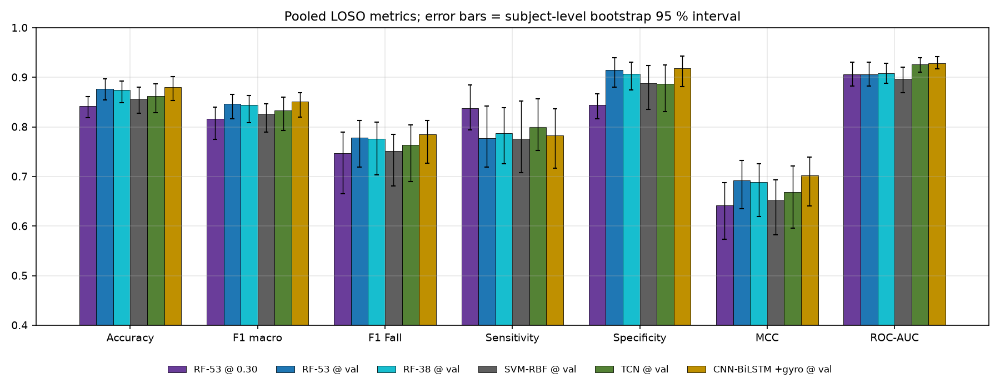
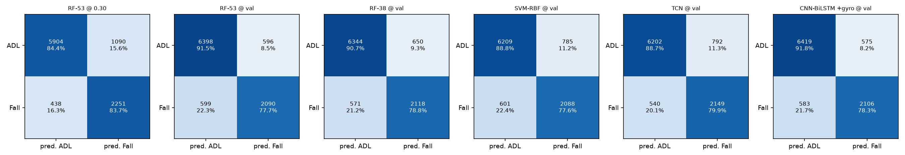
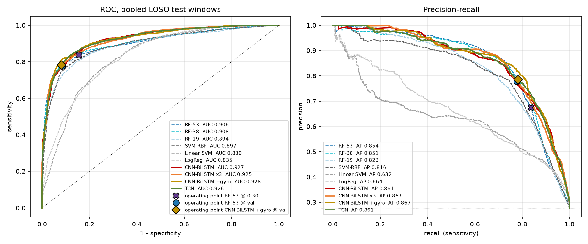
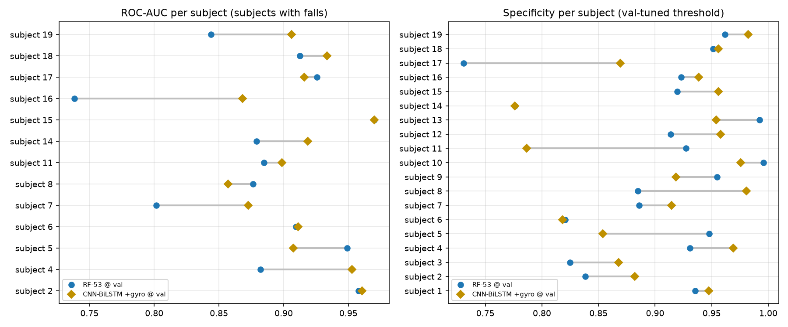
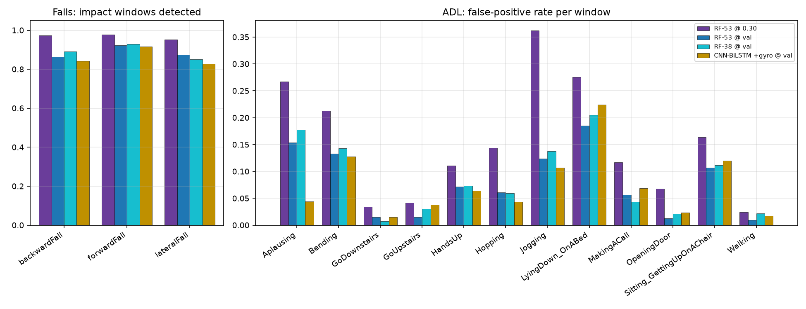
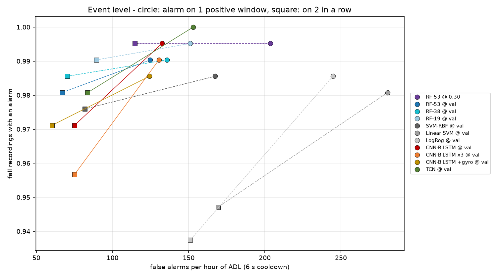

# Evaluation: deep learning vs classic machine learning

_Generated 2026-10-31 13:11 UTC by `python deep_learning/evaluation_report.py`. Every number is computed from saved predictions: the deep models' from `outputs/benchmark/*/predictions.csv`, the classic models' refitted on the same folds (`outputs/evaluation/ml_predictions.csv`). Each table is also written as a CSV next to this file._

## Summary

Best configuration per metric (point estimates; whether a gap is real is decided by the intervals in section 3):

| Metric | Best classic model | Best deep model |
| --- | --- | --- |
| Accuracy | RF-53 @ val: 0.877 | CNN-BiLSTM +gyro @ val: 0.880 |
| F1 macro | RF-53 @ val: 0.846 | CNN-BiLSTM +gyro @ val: 0.851 |
| F1 Fall | RF-53 @ val: 0.778 | CNN-BiLSTM +gyro @ val: 0.784 |
| Sensitivity | RF-53 @ 0.30: 0.837 | TCN @ val: 0.799 |
| Specificity | RF-53 @ val: 0.915 | CNN-BiLSTM +gyro @ val: 0.918 |
| MCC | RF-53 @ val: 0.692 | CNN-BiLSTM +gyro @ val: 0.702 |
| ROC-AUC | RF-38 @ val: 0.908 | CNN-BiLSTM +gyro @ val: 0.928 |
| PR-AUC | RF-53 @ 0.30: 0.854 | CNN-BiLSTM +gyro @ val: 0.867 |
| Impact sens. | RF-53 @ 0.30: 0.969 | CNN-BiLSTM @ val: 0.906 |
| Soft-fall sens. | RF-53 @ 0.30: 0.914 | CNN-BiLSTM x3 @ val: 0.879 |

**CNN-BiLSTM +gyro @ val** (shipped ONNX, picked after comparing):

- vs **RF-53 @ 0.30**, the forest as deployed: higher point estimate on 7 of 10 metrics; clearly higher (interval above 0): Accuracy +0.038, F1 macro +0.035, Specificity +0.074, MCC +0.060, ROC-AUC +0.022; clearly lower (interval below 0): Sensitivity -0.054, Impact sens. -0.106.
- vs **RF-53 @ val**, same forest and same threshold rule: higher point estimate on 8 of 10 metrics; clearly higher (interval above 0): ROC-AUC +0.022; clearly lower (interval below 0): none.
- same sensors (acc), CNN-BiLSTM @ val vs RF-19 @ val: ROC-AUC +0.033 [+0.022, +0.047] ▲; F1 macro +0.023 [+0.00001, +0.044] ▲
- same sensors (acc), CNN-BiLSTM x3 @ val vs RF-19 @ val: ROC-AUC +0.032 [+0.015, +0.051] ▲; F1 macro +0.019 [+0.001, +0.032] ▲
- same sensors (acc + gyro), CNN-BiLSTM +gyro @ val vs RF-38 @ val: ROC-AUC +0.019 [+0.008, +0.034] ▲; F1 macro +0.007 [-0.010, +0.027]
- same sensors (acc), TCN @ val vs RF-19 @ val: ROC-AUC +0.033 [+0.015, +0.047] ▲; F1 macro +0.016 [-0.015, +0.043]
- over all 7 classic configurations x 12 metrics: 44 intervals favour the deep model, 2 the classic model, 38 are inconclusive.
- clustered McNemar test on window errors vs RF-53 @ val: p = 0.668 (472 windows only the deep model gets right, 435 only the forest).
- threshold-free, at a required window sensitivity of 0.90: specificity 0.794 for CNN-BiLSTM +gyro vs 0.634 for RF-53, difference +0.159 [+0.037, +0.220] ▲.
- threshold-free, at a required window sensitivity of 0.95: specificity 0.577 for CNN-BiLSTM +gyro vs 0.414 for RF-53, difference +0.164 [+0.065, +0.290] ▲.
- event level, alarm after 1 positive window(s) in a row: CNN-BiLSTM +gyro @ val detects 0.986 of fall trials with 124.3 false alarms per hour of ADL; RF-53 @ 0.30: 0.995 with 203.6/h.
- event level, alarm after 2 positive window(s) in a row: CNN-BiLSTM +gyro @ val detects 0.971 of fall trials with 60.2 false alarms per hour of ADL; RF-53 @ 0.30: 0.995 with 114.7/h.
- cost per window: 1.28 M MACs for CNN-BiLSTM +gyro @ val vs ~560 comparisons + 53 features for the forest; only the forest runs on the ESP32-C3 today.

## 1. Protocol

Identical for every model:

- **Data:** the 9683 windows of `ml_pipeline` (2689 Fall / 6994 ADL) from 746 UMAFall wrist recordings of 19 subjects; 2.0 s windows, 1.0 s hop, file-level labels.
- **Folds:** leave-one-subject-out, 19 folds. Per fold 3 validation subjects (drawn from the subjects with falls, never subject 18) and the rest for training. The test subject is never seen by a model or by threshold selection.
- **Threshold:** Youden's J on the validation subjects (`@ val`); the deployed forest also at its firmware threshold 0.30 (`@ 0.30`).
- **Pooling:** metrics are computed over all test windows at once (folds hold 130 to 2457 windows).
- **Uncertainty:** subject-level bootstrap, 2000 resamples of the 19 subjects, paired across models; 95 % percentile intervals. ▲ = interval above zero (deep model higher), ▼ = below zero (classic model higher), no mark = inconclusive.
- **Check:** the forest refitted here reproduces the forest stored in every benchmark run to 4.4e-16 (probabilities and thresholds).

| Configuration | Family | Sensors | Model input | Role |
| --- | --- | --- | --- | --- |
| RF-53 @ 0.30 | ML | acc + gyro + mag | 53 features | deployed in ml_inference |
| RF-53 @ val | ML | acc + gyro + mag | 53 features |  |
| RF-38 @ val | ML | acc + gyro | 38 features |  |
| RF-19 @ val | ML | acc | 19 features |  |
| SVM-RBF @ val | ML | acc + gyro + mag | 53 features |  |
| Linear SVM @ val | ML | acc + gyro + mag | 53 features |  |
| LogReg @ val | ML | acc + gyro + mag | 53 features |  |
| CNN-BiLSTM @ val | DL | acc | raw 3 x 100 -> 5 channels |  |
| CNN-BiLSTM x3 @ val | DL | acc | raw 3 x 100 -> 5 channels |  |
| CNN-BiLSTM +gyro @ val | DL | acc + gyro | raw 6 x 100 -> 9 channels | shipped ONNX, picked after comparing |
| TCN @ val | DL | acc | raw 3 x 100 -> 5 channels | pre-specified |

SVM scores are the decision value passed through a logistic function: monotonic, so the ROC is unchanged and 0.5 is the SVM's own boundary, but not a probability, so no Brier score is given. RF-38 and RF-19 are the deployed forest's settings on the features of fewer sensors, so the deep models can be compared with a forest that sees the same sensors.

## 2. Window-level results

Table 1 - thresholded metrics, pooled over all test windows (best per column in bold).

| Configuration | Accuracy | Balanced acc. | F1 macro | F1 Fall | Sensitivity | Specificity | Precision | MCC |
| --- | :---: | :---: | :---: | :---: | :---: | :---: | :---: | :---: |
| RF-53 @ 0.30 | 0.842 | 0.841 | 0.816 | 0.747 | **0.837** | 0.844 | 0.674 | 0.642 |
| RF-53 @ val | 0.877 | 0.846 | 0.846 | 0.778 | 0.777 | 0.915 | 0.778 | 0.692 |
| RF-38 @ val | 0.874 | 0.847 | 0.844 | 0.776 | 0.788 | 0.907 | 0.765 | 0.689 |
| RF-19 @ val | 0.850 | 0.823 | 0.817 | 0.739 | 0.761 | 0.885 | 0.718 | 0.635 |
| SVM-RBF @ val | 0.857 | 0.832 | 0.825 | 0.751 | 0.776 | 0.888 | 0.727 | 0.651 |
| Linear SVM @ val | 0.749 | 0.741 | 0.714 | 0.615 | 0.721 | 0.760 | 0.536 | 0.445 |
| LogReg @ val | 0.764 | 0.741 | 0.724 | 0.619 | 0.690 | 0.792 | 0.560 | 0.455 |
| CNN-BiLSTM @ val | 0.870 | 0.844 | 0.840 | 0.770 | 0.784 | 0.903 | 0.756 | 0.680 |
| CNN-BiLSTM x3 @ val | 0.867 | 0.839 | 0.836 | 0.764 | 0.775 | 0.902 | 0.753 | 0.672 |
| CNN-BiLSTM +gyro @ val | **0.880** | **0.850** | **0.851** | **0.784** | 0.783 | **0.918** | **0.786** | **0.702** |
| TCN @ val | 0.862 | 0.843 | 0.833 | 0.763 | 0.799 | 0.887 | 0.731 | 0.668 |

Table 2 - threshold-free metrics, sensitivity on the fall itself, and counts.

| Configuration | ROC-AUC | PR-AUC | Impact sens. | Soft-fall sens. | Brier (lower = better) | TP | FP | TN | FN |
| --- | :---: | :---: | :---: | :---: | :---: | :---: | :---: | :---: | :---: |
| RF-53 @ 0.30 | 0.906 | 0.854 | **0.969** | **0.914** | 0.094 | 2251 | 1090 | 5904 | 438 |
| RF-53 @ val | 0.906 | 0.854 | 0.887 | 0.771 | 0.094 | 2090 | 596 | 6398 | 599 |
| RF-38 @ val | 0.908 | 0.851 | 0.892 | 0.807 | **0.093** | 2118 | 650 | 6344 | 571 |
| RF-19 @ val | 0.894 | 0.823 | 0.878 | 0.771 | 0.105 | 2046 | 805 | 6189 | 643 |
| SVM-RBF @ val | 0.897 | 0.816 | 0.875 | 0.800 | - | 2088 | 785 | 6209 | 601 |
| Linear SVM @ val | 0.830 | 0.632 | 0.827 | 0.721 | - | 1940 | 1681 | 5313 | 749 |
| LogReg @ val | 0.835 | 0.664 | 0.839 | 0.736 | 0.168 | 1856 | 1456 | 5538 | 833 |
| CNN-BiLSTM @ val | 0.927 | 0.861 | 0.906 | 0.850 | 0.126 | 2109 | 679 | 6315 | 580 |
| CNN-BiLSTM x3 @ val | 0.925 | 0.863 | 0.902 | 0.879 | 0.121 | 2085 | 684 | 6310 | 604 |
| CNN-BiLSTM +gyro @ val | **0.928** | **0.867** | 0.863 | 0.757 | 0.117 | 2106 | 575 | 6419 | 583 |
| TCN @ val | 0.926 | 0.861 | 0.906 | 0.843 | 0.121 | 2149 | 792 | 6202 | 540 |

Impact sens. = share of impact windows flagged (the windows that contain a fall's peak |a|; 417 windows). Soft-fall sens. = the same for the softest third of falls (peak |a| <= 5.04 g; 140 windows). With file-level labels most Fall windows are the standing and lying around the impact; these two columns measure the fall itself.

Table 3 - main configurations with 95 % intervals.

| Configuration | Accuracy | F1 macro | F1 Fall | Sensitivity | Specificity | MCC | ROC-AUC |
| --- | :---: | :---: | :---: | :---: | :---: | :---: | :---: |
| RF-53 @ 0.30 | 0.842 [0.818, 0.861] | 0.816 [0.775, 0.840] | 0.747 [0.665, 0.789] | 0.837 [0.793, 0.884] | 0.844 [0.816, 0.867] | 0.642 [0.573, 0.688] | 0.906 [0.883, 0.930] |
| RF-53 @ val | 0.877 [0.854, 0.897] | 0.846 [0.816, 0.866] | 0.778 [0.719, 0.812] | 0.777 [0.719, 0.842] | 0.915 [0.880, 0.939] | 0.692 [0.635, 0.732] | 0.906 [0.883, 0.930] |
| RF-38 @ val | 0.874 [0.849, 0.893] | 0.844 [0.808, 0.863] | 0.776 [0.703, 0.809] | 0.788 [0.726, 0.839] | 0.907 [0.874, 0.931] | 0.689 [0.619, 0.726] | 0.908 [0.888, 0.928] |
| SVM-RBF @ val | 0.857 [0.827, 0.880] | 0.825 [0.789, 0.846] | 0.751 [0.681, 0.784] | 0.776 [0.708, 0.852] | 0.888 [0.835, 0.923] | 0.651 [0.582, 0.693] | 0.897 [0.869, 0.921] |
| TCN @ val | 0.862 [0.828, 0.887] | 0.833 [0.793, 0.860] | 0.763 [0.690, 0.804] | 0.799 [0.753, 0.857] | 0.887 [0.831, 0.925] | 0.668 [0.596, 0.721] | 0.926 [0.910, 0.939] |
| CNN-BiLSTM +gyro @ val | 0.880 [0.853, 0.901] | 0.851 [0.820, 0.869] | 0.784 [0.726, 0.813] | 0.783 [0.716, 0.836] | 0.918 [0.881, 0.943] | 0.702 [0.641, 0.739] | 0.928 [0.917, 0.942] |

## 3. Head-to-head: is the difference real?

Table 4 - **CNN-BiLSTM +gyro @ val** minus each classic model; cell = difference [95 % interval].

| Metric | RF-53 @ 0.30 | RF-53 @ val | RF-38 @ val | RF-19 @ val | SVM-RBF @ val | Linear SVM @ val | LogReg @ val |
| --- | :---: | :---: | :---: | :---: | :---: | :---: | :---: |
| Accuracy | +0.038 [+0.012, +0.062] ▲ | +0.004 [-0.017, +0.019] | +0.007 [-0.009, +0.023] | +0.030 [+0.014, +0.047] ▲ | +0.024 [+0.008, +0.042] ▲ | +0.131 [+0.093, +0.185] ▲ | +0.117 [+0.080, +0.160] ▲ |
| Balanced acc. | +0.010 [-0.016, +0.031] | +0.004 [-0.019, +0.023] | +0.003 [-0.010, +0.021] | +0.028 [+0.010, +0.043] ▲ | +0.018 [+0.003, +0.031] ▲ | +0.110 [+0.065, +0.144] ▲ | +0.109 [+0.059, +0.148] ▲ |
| F1 macro | +0.035 [+0.006, +0.063] ▲ | +0.005 [-0.020, +0.024] | +0.007 [-0.010, +0.027] | +0.034 [+0.016, +0.052] ▲ | +0.026 [+0.008, +0.045] ▲ | +0.136 [+0.095, +0.183] ▲ | +0.127 [+0.083, +0.169] ▲ |
| F1 Fall | +0.038 [-0.002, +0.080] | +0.007 [-0.027, +0.035] | +0.008 [-0.014, +0.037] | +0.046 [+0.022, +0.072] ▲ | +0.034 [+0.010, +0.062] ▲ | +0.169 [+0.104, +0.237] ▲ | +0.166 [+0.095, +0.233] ▲ |
| Sensitivity | -0.054 [-0.106, -0.012] ▼ | +0.006 [-0.037, +0.038] | -0.004 [-0.036, +0.032] | +0.022 [-0.021, +0.066] | +0.007 [-0.027, +0.033] | +0.062 [-0.051, +0.158] | +0.093 [-0.025, +0.198] |
| Specificity | +0.074 [+0.043, +0.101] ▲ | +0.003 [-0.020, +0.023] | +0.011 [-0.015, +0.034] | +0.033 [+0.002, +0.061] ▲ | +0.030 [+0.007, +0.062] ▲ | +0.158 [+0.096, +0.248] ▲ | +0.126 [+0.071, +0.208] ▲ |
| Precision | +0.112 [+0.053, +0.173] ▲ | +0.007 [-0.039, +0.048] | +0.020 [-0.027, +0.068] | +0.068 [+0.016, +0.123] ▲ | +0.059 [+0.017, +0.108] ▲ | +0.250 [+0.171, +0.336] ▲ | +0.225 [+0.147, +0.306] ▲ |
| MCC | +0.060 [+0.004, +0.109] ▲ | +0.009 [-0.039, +0.047] | +0.013 [-0.021, +0.051] | +0.067 [+0.032, +0.100] ▲ | +0.050 [+0.016, +0.086] ▲ | +0.256 [+0.162, +0.333] ▲ | +0.247 [+0.148, +0.321] ▲ |
| ROC-AUC | +0.022 [+0.007, +0.039] ▲ | +0.022 [+0.007, +0.039] ▲ | +0.019 [+0.008, +0.034] ▲ | +0.034 [+0.022, +0.049] ▲ | +0.031 [+0.013, +0.052] ▲ | +0.098 [+0.068, +0.141] ▲ | +0.093 [+0.065, +0.132] ▲ |
| PR-AUC | +0.013 [-0.014, +0.039] | +0.013 [-0.014, +0.039] | +0.016 [-0.002, +0.042] | +0.044 [+0.024, +0.077] ▲ | +0.051 [+0.018, +0.088] ▲ | +0.235 [+0.154, +0.350] ▲ | +0.203 [+0.131, +0.307] ▲ |
| Impact sens. | -0.106 [-0.175, -0.019] ▼ | -0.024 [-0.099, +0.033] | -0.029 [-0.097, +0.052] | -0.014 [-0.096, +0.094] | -0.012 [-0.077, +0.077] | +0.036 [-0.016, +0.105] | +0.024 [-0.026, +0.076] |
| Soft-fall sens. | -0.157 [-0.320, +0.018] | -0.014 [-0.153, +0.112] | -0.050 [-0.203, +0.108] | -0.014 [-0.199, +0.177] | -0.043 [-0.186, +0.100] | +0.036 [-0.104, +0.159] | +0.021 [-0.104, +0.134] |

Table 5 - same sensors on both sides: every deep model against the forest built from the same sensors' features (both @ val).

| Deep model | Forest | Sensors | ROC-AUC | F1 macro | Accuracy | Sensitivity | Specificity | MCC |
| --- | --- | --- | :---: | :---: | :---: | :---: | :---: | :---: |
| CNN-BiLSTM @ val | RF-19 @ val | acc | +0.033 [+0.022, +0.047] ▲ | +0.023 [+0.00001, +0.044] ▲ | +0.020 [-0.004, +0.040] | +0.023 [-0.018, +0.072] | +0.018 [-0.023, +0.052] | +0.045 [+0.003, +0.085] ▲ |
| CNN-BiLSTM x3 @ val | RF-19 @ val | acc | +0.032 [+0.015, +0.051] ▲ | +0.019 [+0.001, +0.032] ▲ | +0.017 [-0.002, +0.030] | +0.015 [-0.016, +0.056] | +0.017 [-0.018, +0.043] | +0.037 [+0.005, +0.064] ▲ |
| CNN-BiLSTM +gyro @ val | RF-38 @ val | acc + gyro | +0.019 [+0.008, +0.034] ▲ | +0.007 [-0.010, +0.027] | +0.007 [-0.009, +0.023] | -0.004 [-0.036, +0.032] | +0.011 [-0.015, +0.034] | +0.013 [-0.021, +0.051] |
| TCN @ val | RF-19 @ val | acc | +0.033 [+0.015, +0.047] ▲ | +0.016 [-0.015, +0.043] | +0.012 [-0.020, +0.038] | +0.038 [+0.013, +0.074] ▲ | +0.002 [-0.047, +0.040] | +0.033 [-0.021, +0.084] |

Table 6 - every deep model against the deployed forest.

| Deep model | Forest | Accuracy | F1 macro | F1 Fall | Sensitivity | Specificity | ROC-AUC |
| --- | --- | :---: | :---: | :---: | :---: | :---: | :---: |
| CNN-BiLSTM @ val | RF-53 @ 0.30 | +0.028 [-0.00000, +0.052] | +0.024 [-0.007, +0.050] | +0.024 [-0.018, +0.061] | -0.053 [-0.106, -0.001] ▼ | +0.059 [+0.017, +0.088] ▲ | +0.021 [+0.004, +0.041] ▲ |
| CNN-BiLSTM @ val | RF-53 @ val | -0.007 [-0.032, +0.011] | -0.006 [-0.035, +0.015] | -0.008 [-0.048, +0.022] | +0.007 [-0.043, +0.048] | -0.012 [-0.048, +0.011] | +0.021 [+0.004, +0.041] ▲ |
| CNN-BiLSTM x3 @ val | RF-53 @ 0.30 | +0.025 [-0.004, +0.046] | +0.020 [-0.012, +0.045] | +0.017 [-0.026, +0.055] | -0.062 [-0.123, +0.003] | +0.058 [+0.021, +0.085] ▲ | +0.020 [-0.007, +0.043] |
| CNN-BiLSTM x3 @ val | RF-53 @ val | -0.010 [-0.036, +0.008] | -0.010 [-0.043, +0.010] | -0.014 [-0.060, +0.015] | -0.002 [-0.058, +0.051] | -0.013 [-0.045, +0.009] | +0.020 [-0.007, +0.043] |
| CNN-BiLSTM +gyro @ val | RF-53 @ 0.30 | +0.038 [+0.012, +0.062] ▲ | +0.035 [+0.006, +0.063] ▲ | +0.038 [-0.002, +0.080] | -0.054 [-0.106, -0.012] ▼ | +0.074 [+0.043, +0.101] ▲ | +0.022 [+0.007, +0.039] ▲ |
| CNN-BiLSTM +gyro @ val | RF-53 @ val | +0.004 [-0.017, +0.019] | +0.005 [-0.020, +0.024] | +0.007 [-0.027, +0.035] | +0.006 [-0.037, +0.038] | +0.003 [-0.020, +0.023] | +0.022 [+0.007, +0.039] ▲ |
| TCN @ val | RF-53 @ 0.30 | +0.020 [-0.013, +0.046] | +0.017 [-0.020, +0.046] | +0.017 [-0.035, +0.058] | -0.038 [-0.104, +0.022] | +0.043 [-0.002, +0.073] | +0.021 [-0.005, +0.040] |
| TCN @ val | RF-53 @ val | -0.014 [-0.048, +0.009] | -0.013 [-0.053, +0.015] | -0.014 [-0.072, +0.024] | +0.022 [-0.045, +0.079] | -0.028 [-0.067, -0.002] ▼ | +0.021 [-0.005, +0.040] |

Table 7 - McNemar test on window-level errors (each model at its own threshold).

| Deep model | Classic model | Only DL correct | Only ML correct | p, windows independent | p, clustered by subject |
| --- | --- | :---: | :---: | :---: | :---: |
| CNN-BiLSTM +gyro @ val | RF-53 @ 0.30 | 815 | 445 | < 0.001 | 0.026 |
| CNN-BiLSTM +gyro @ val | RF-53 @ val | 472 | 435 | 0.232 | 0.668 |
| CNN-BiLSTM +gyro @ val | RF-38 @ val | 506 | 443 | 0.044 | 0.390 |
| CNN-BiLSTM +gyro @ val | RF-19 @ val | 731 | 441 | < 0.001 | 0.021 |
| CNN-BiLSTM +gyro @ val | SVM-RBF @ val | 698 | 470 | < 0.001 | 0.019 |
| CNN-BiLSTM +gyro @ val | Linear SVM @ val | 1718 | 446 | < 0.001 | 0.002 |
| CNN-BiLSTM +gyro @ val | LogReg @ val | 1603 | 472 | < 0.001 | 0.003 |
| CNN-BiLSTM @ val | RF-19 @ val | 663 | 474 | < 0.001 | 0.125 |
| CNN-BiLSTM x3 @ val | RF-19 @ val | 597 | 437 | < 0.001 | 0.129 |
| TCN @ val | RF-19 @ val | 676 | 560 | 0.001 | 0.435 |

The first p-value treats the overlapping windows as independent and is too small; the clustered test (Durkalski et al., 2003) counts each subject as one cluster and is the one to read.

## 4. Threshold-free comparison

Table 8 - each model's pooled ROC curve read at fixed operating points (best per column in bold). This compares the curves themselves, wherever a threshold was put; the levels are read off the pooled test curves, so they are not deployable thresholds.

| Model | Family | Spec. @ sens. 0.80 | Spec. @ sens. 0.90 | Spec. @ sens. 0.95 | Sens. @ spec. 0.90 | Sens. @ spec. 0.95 |
| --- | --- | :---: | :---: | :---: | :---: | :---: |
| RF-53 | ML | 0.892 | 0.634 | 0.414 | 0.795 | **0.736** |
| RF-38 | ML | 0.901 | 0.659 | 0.416 | 0.801 | 0.728 |
| RF-19 | ML | 0.855 | 0.648 | 0.410 | 0.747 | 0.643 |
| SVM-RBF | ML | 0.865 | 0.654 | 0.433 | 0.769 | 0.633 |
| Linear SVM | ML | 0.705 | 0.586 | 0.455 | 0.461 | 0.285 |
| LogReg | ML | 0.692 | 0.575 | 0.470 | 0.507 | 0.353 |
| CNN-BiLSTM | DL | 0.895 | **0.795** | 0.576 | 0.792 | 0.716 |
| CNN-BiLSTM x3 | DL | 0.900 | 0.748 | **0.600** | 0.801 | 0.727 |
| CNN-BiLSTM +gyro | DL | **0.923** | 0.794 | 0.577 | **0.822** | 0.733 |
| TCN | DL | 0.908 | 0.773 | 0.599 | 0.811 | 0.714 |

Table 9 - the same read-outs as differences, DL - ML [95 % interval]. The forest's curve does not depend on its threshold, so RF-53 @ 0.30 and RF-53 @ val share a row.

| Deep model | Classic model | Spec. @ sens. 0.80 | Spec. @ sens. 0.90 | Spec. @ sens. 0.95 | Sens. @ spec. 0.90 | Sens. @ spec. 0.95 |
| --- | --- | :---: | :---: | :---: | :---: | :---: |
| CNN-BiLSTM +gyro | RF-53 | +0.031 [-0.018, +0.064] | +0.159 [+0.037, +0.220] ▲ | +0.164 [+0.065, +0.290] ▲ | +0.027 [-0.009, +0.050] | -0.003 [-0.071, +0.057] |
| CNN-BiLSTM +gyro | RF-38 | +0.022 [-0.014, +0.056] | +0.135 [+0.014, +0.191] ▲ | +0.162 [+0.060, +0.254] ▲ | +0.021 [-0.007, +0.055] | +0.005 [-0.045, +0.068] |
| CNN-BiLSTM | RF-19 | +0.040 [+0.005, +0.078] ▲ | +0.147 [+0.040, +0.210] ▲ | +0.166 [+0.089, +0.352] ▲ | +0.044 [-0.004, +0.094] | +0.072 [+0.011, +0.137] ▲ |
| CNN-BiLSTM x3 | RF-19 | +0.045 [+0.004, +0.079] ▲ | +0.100 [-0.018, +0.197] | +0.190 [+0.044, +0.343] ▲ | +0.054 [+0.023, +0.085] ▲ | +0.084 [+0.034, +0.163] ▲ |
| TCN | RF-19 | +0.054 [+0.022, +0.093] ▲ | +0.125 [+0.019, +0.204] ▲ | +0.189 [+0.027, +0.329] ▲ | +0.064 [+0.014, +0.104] ▲ | +0.071 [+0.013, +0.141] ▲ |

## 5. Per subject

Table 10 - RF-53 @ val vs CNN-BiLSTM +gyro @ val on each held-out subject.

| Subject | Windows | Fall windows | AUC RF | AUC DL | Sens. RF | Sens. DL | Spec. RF | Spec. DL |
| --- | :---: | :---: | :---: | :---: | :---: | :---: | :---: | :---: |
| 1 | 247 | 0 | - | - | - | - | 0.935 | 0.947 |
| 2 | 637 | 247 | 0.958 | 0.960 | 0.943 | 0.899 | 0.838 | 0.882 |
| 3 | 234 | 0 | - | - | - | - | 0.825 | 0.868 |
| 4 | 542 | 152 | 0.882 | 0.953 | 0.776 | 0.836 | 0.931 | 0.969 |
| 5 | 637 | 234 | 0.949 | 0.907 | 0.846 | 0.799 | 0.948 | 0.854 |
| 6 | 650 | 221 | 0.909 | 0.911 | 0.846 | 0.882 | 0.821 | 0.818 |
| 7 | 429 | 78 | 0.802 | 0.873 | 0.526 | 0.641 | 0.886 | 0.915 |
| 8 | 130 | 78 | 0.876 | 0.857 | 0.692 | 0.769 | 0.885 | 0.981 |
| 9 | 442 | 0 | - | - | - | - | 0.955 | 0.919 |
| 10 | 247 | 0 | - | - | - | - | 0.996 | 0.976 |
| 11 | 465 | 231 | 0.885 | 0.899 | 0.762 | 0.792 | 0.927 | 0.786 |
| 12 | 429 | 0 | - | - | - | - | 0.914 | 0.958 |
| 13 | 260 | 0 | - | - | - | - | 0.992 | 0.954 |
| 14 | 416 | 117 | 0.879 | 0.919 | 0.838 | 0.915 | 0.776 | 0.776 |
| 15 | 429 | 156 | 0.970 | 0.970 | 0.910 | 0.776 | 0.919 | 0.956 |
| 16 | 135 | 70 | 0.738 | 0.868 | 0.514 | 0.514 | 0.923 | 0.938 |
| 17 | 273 | 143 | 0.926 | 0.916 | 0.916 | 0.888 | 0.731 | 0.869 |
| 18 | 2457 | 728 | 0.912 | 0.934 | 0.725 | 0.773 | 0.951 | 0.956 |
| 19 | 624 | 234 | 0.844 | 0.906 | 0.632 | 0.547 | 0.962 | 0.982 |

Table 11 - Wilcoxon signed-rank test on per-subject differences (two-sided).

| Deep model | Classic model | Metric | Subjects | DL better | ML better | Median difference | p |
| --- | --- | --- | :---: | :---: | :---: | :---: | :---: |
| CNN-BiLSTM +gyro @ val | RF-53 @ val | ROC-AUC | 13 | 9 | 4 | +0.014 | 0.080 |
| CNN-BiLSTM +gyro @ val | RF-53 @ val | Balanced acc. | 13 | 8 | 5 | +0.017 | 0.497 |
| CNN-BiLSTM +gyro @ val | RF-53 @ val | Sensitivity | 13 | 7 | 5 | +0.030 | 0.622 |
| CNN-BiLSTM +gyro @ val | RF-53 @ val | Specificity | 19 | 12 | 6 | +0.015 | 0.223 |
| CNN-BiLSTM +gyro @ val | RF-53 @ val | Accuracy | 19 | 12 | 7 | +0.011 | 0.515 |
| CNN-BiLSTM +gyro @ val | RF-53 @ 0.30 | ROC-AUC | 13 | 9 | 4 | +0.014 | 0.080 |
| CNN-BiLSTM +gyro @ val | RF-53 @ 0.30 | Balanced acc. | 13 | 8 | 5 | +0.024 | 0.273 |
| CNN-BiLSTM +gyro @ val | RF-53 @ 0.30 | Sensitivity | 13 | 5 | 8 | -0.033 | 0.094 |
| CNN-BiLSTM +gyro @ val | RF-53 @ 0.30 | Specificity | 19 | 14 | 4 | +0.085 | 0.001 |
| CNN-BiLSTM +gyro @ val | RF-53 @ 0.30 | Accuracy | 19 | 15 | 3 | +0.033 | 0.006 |
| CNN-BiLSTM @ val | RF-19 @ val | ROC-AUC | 13 | 12 | 1 | +0.032 | < 0.001 |
| CNN-BiLSTM @ val | RF-19 @ val | Balanced acc. | 13 | 9 | 4 | +0.018 | 0.216 |
| CNN-BiLSTM @ val | RF-19 @ val | Sensitivity | 13 | 9 | 4 | +0.041 | 0.455 |
| CNN-BiLSTM @ val | RF-19 @ val | Specificity | 19 | 14 | 5 | +0.012 | 0.198 |
| CNN-BiLSTM @ val | RF-19 @ val | Accuracy | 19 | 12 | 6 | +0.016 | 0.108 |
| CNN-BiLSTM x3 @ val | RF-19 @ val | ROC-AUC | 13 | 12 | 1 | +0.038 | 0.002 |
| CNN-BiLSTM x3 @ val | RF-19 @ val | Balanced acc. | 13 | 11 | 2 | +0.018 | 0.040 |
| CNN-BiLSTM x3 @ val | RF-19 @ val | Sensitivity | 13 | 9 | 4 | +0.049 | 0.110 |
| CNN-BiLSTM x3 @ val | RF-19 @ val | Specificity | 19 | 11 | 8 | +0.008 | 0.490 |
| CNN-BiLSTM x3 @ val | RF-19 @ val | Accuracy | 19 | 12 | 6 | +0.014 | 0.167 |
| CNN-BiLSTM +gyro @ val | RF-38 @ val | ROC-AUC | 13 | 10 | 3 | +0.015 | 0.110 |
| CNN-BiLSTM +gyro @ val | RF-38 @ val | Balanced acc. | 13 | 9 | 4 | +0.011 | 0.340 |
| CNN-BiLSTM +gyro @ val | RF-38 @ val | Sensitivity | 13 | 7 | 6 | +0.013 | 0.685 |
| CNN-BiLSTM +gyro @ val | RF-38 @ val | Specificity | 19 | 12 | 5 | +0.017 | 0.207 |
| CNN-BiLSTM +gyro @ val | RF-38 @ val | Accuracy | 19 | 12 | 6 | +0.011 | 0.167 |
| TCN @ val | RF-19 @ val | ROC-AUC | 13 | 12 | 1 | +0.038 | 0.002 |
| TCN @ val | RF-19 @ val | Balanced acc. | 13 | 10 | 3 | +0.040 | 0.080 |
| TCN @ val | RF-19 @ val | Sensitivity | 13 | 11 | 2 | +0.049 | 0.027 |
| TCN @ val | RF-19 @ val | Specificity | 19 | 9 | 9 | +0.000 | 0.799 |
| TCN @ val | RF-19 @ val | Accuracy | 19 | 10 | 8 | +0.005 | 0.495 |

Subjects 1, 3, 9, 10, 12, 13 recorded no falls: they have no sensitivity or AUC, so those rows rest on the remaining subjects. With so few subjects a Wilcoxon test can only detect large, consistent differences.

## 6. Per activity

Table 12 - falls: impact windows detected / all fall windows flagged.

| Fall type | Recordings | RF-53 @ 0.30 | RF-53 @ val | RF-38 @ val | SVM-RBF @ val | TCN @ val | CNN-BiLSTM +gyro @ val |
| --- | :---: | :---: | :---: | :---: | :---: | :---: | :---: |
| backwardFall | 73 | 0.97 / 0.84 | 0.86 / 0.76 | 0.89 / 0.79 | 0.89 / 0.72 | 0.90 / 0.78 | 0.84 / 0.79 |
| forwardFall | 71 | 0.98 / 0.82 | 0.92 / 0.78 | 0.93 / 0.79 | 0.91 / 0.81 | 0.90 / 0.84 | 0.92 / 0.80 |
| lateralFall | 64 | 0.95 / 0.85 | 0.88 / 0.79 | 0.85 / 0.78 | 0.82 / 0.81 | 0.91 / 0.78 | 0.83 / 0.76 |

Table 13 - ADL: false-positive rate per window, lower is better (best in bold); sorted by the mean over the columns.

| Activity | Recordings | RF-53 @ 0.30 | RF-53 @ val | RF-38 @ val | SVM-RBF @ val | TCN @ val | CNN-BiLSTM +gyro @ val |
| --- | :---: | :---: | :---: | :---: | :---: | :---: | :---: |
| LyingDown_OnABed | 57 | 0.275 | **0.185** | 0.205 | 0.223 | 0.248 | 0.224 |
| Bending | 59 | 0.213 | 0.133 | 0.143 | 0.207 | 0.172 | **0.128** |
| Jogging | 28 | 0.363 | 0.124 | 0.137 | **0.066** | 0.107 | 0.107 |
| Sitting_GettingUpOnAChair | 64 | 0.163 | **0.107** | 0.112 | 0.204 | 0.173 | 0.120 |
| Aplausing | 42 | 0.267 | 0.154 | 0.178 | 0.145 | 0.079 | **0.044** |
| HandsUp | 43 | 0.111 | 0.072 | 0.073 | **0.061** | 0.109 | 0.064 |
| MakingACall | 46 | 0.117 | 0.057 | **0.043** | 0.089 | 0.099 | 0.069 |
| Hopping | 53 | 0.144 | 0.061 | 0.060 | 0.048 | **0.042** | 0.044 |
| OpeningDoor | 43 | 0.068 | **0.013** | 0.021 | 0.047 | 0.089 | 0.023 |
| GoUpstairs | 20 | 0.042 | **0.015** | 0.031 | 0.023 | 0.027 | 0.038 |
| Walking | 63 | 0.024 | **0.010** | 0.022 | 0.031 | 0.044 | 0.017 |
| GoDownstairs | 20 | 0.035 | 0.015 | **0.008** | 0.042 | 0.031 | 0.015 |

## 7. Event level: one alarm decision per recording

The device raises alarms, not window labels. Each recording (a ~14 s trial) is replayed window by window: an alarm needs 1 positive window (`CONFIRMATION_WINDOWS = 1`, as in `inference_main.cpp`) or 2 in a row, and is followed by a 6 s cooldown. A fall trial is detected if it raised at least one alarm; an ADL trial is a false alarm if it raised any. False alarms per hour count every alarm during the 2.09 h of ADL recordings.

Table 14 - recording level, at each model's window-level threshold.

| Configuration | Windows in a row | Fall trials detected | ADL trials without alarm | Missed falls (of 208) | ADL trials with alarm (of 538) | False alarms / h |
| --- | :---: | :---: | :---: | :---: | :---: | :---: |
| RF-53 @ 0.30 | 1 | 0.995 | 0.450 | 1 | 296 | 203.6 |
| RF-53 @ val | 1 | 0.990 | 0.621 | 2 | 204 | 124.7 |
| RF-38 @ val | 1 | 0.990 | 0.591 | 2 | 220 | 135.7 |
| RF-19 @ val | 1 | 0.995 | 0.567 | 1 | 233 | 151.0 |
| SVM-RBF @ val | 1 | 0.986 | 0.517 | 3 | 260 | 167.3 |
| Linear SVM @ val | 1 | 0.981 | 0.338 | 4 | 356 | 280.6 |
| LogReg @ val | 1 | 0.986 | 0.394 | 3 | 326 | 244.7 |
| CNN-BiLSTM @ val | 1 | 0.995 | 0.591 | 1 | 220 | 132.4 |
| CNN-BiLSTM x3 @ val | 1 | 0.990 | 0.612 | 2 | 209 | 130.5 |
| CNN-BiLSTM +gyro @ val | 1 | 0.986 | 0.619 | 3 | 205 | 124.3 |
| TCN @ val | 1 | 1.000 | 0.528 | 0 | 254 | 152.9 |
| RF-53 @ 0.30 | 2 | 0.995 | 0.632 | 1 | 198 | 114.7 |
| RF-53 @ val | 2 | 0.981 | 0.771 | 4 | 123 | 66.9 |
| RF-38 @ val | 2 | 0.986 | 0.760 | 3 | 129 | 70.3 |
| RF-19 @ val | 2 | 0.990 | 0.712 | 2 | 155 | 89.4 |
| SVM-RBF @ val | 2 | 0.976 | 0.725 | 5 | 148 | 81.7 |
| Linear SVM @ val | 2 | 0.947 | 0.507 | 11 | 265 | 169.2 |
| LogReg @ val | 2 | 0.938 | 0.569 | 13 | 232 | 151.0 |
| CNN-BiLSTM @ val | 2 | 0.971 | 0.757 | 6 | 131 | 75.0 |
| CNN-BiLSTM x3 @ val | 2 | 0.957 | 0.757 | 9 | 131 | 75.0 |
| CNN-BiLSTM +gyro @ val | 2 | 0.971 | 0.788 | 6 | 114 | 60.2 |
| TCN @ val | 2 | 0.981 | 0.723 | 4 | 149 | 83.6 |
| Rule-based cascade, raw_stream (README 9.4) | - | 0.856 | 0.942 | 30 | 31 | not measured |

The window thresholds were tuned for windows, not for trials, so these are not each model's best event-level setting. The rule-based row is quoted from README 9.4 (separate run, same recordings and question, its own thresholds chosen by LOSO), for reference.

Table 15 - recording-level ROC-AUC, threshold-free: the recording score is its highest window probability (1 window) or its best pair of consecutive windows (2 in a row).

| Model | Family | AUC, 1 window | AUC, 2 in a row | Sens. @ spec. 0.95, 1 window | Sens. @ spec. 0.95, 2 in a row |
| --- | --- | :---: | :---: | :---: | :---: |
| RF-53 | ML | 0.968 | 0.975 | 0.837 | 0.880 |
| RF-38 | ML | 0.964 | 0.973 | 0.817 | 0.885 |
| RF-19 | ML | 0.953 | 0.967 | 0.688 | 0.774 |
| SVM-RBF | ML | 0.922 | 0.945 | 0.553 | 0.707 |
| Linear SVM | ML | 0.906 | 0.892 | 0.639 | 0.572 |
| LogReg | ML | 0.922 | 0.909 | 0.668 | 0.649 |
| CNN-BiLSTM | DL | 0.981 | 0.971 | 0.899 | 0.812 |
| CNN-BiLSTM x3 | DL | 0.977 | 0.969 | 0.889 | 0.841 |
| CNN-BiLSTM +gyro | DL | 0.975 | 0.971 | 0.875 | 0.817 |
| TCN | DL | 0.970 | 0.969 | 0.793 | 0.846 |

Table 16 - event-level differences, DL - ML [95 % interval]. For false alarms per hour lower is better: ▲ there means the deep model raises fewer.

| Deep model | Classic model | In a row | Sensitivity | Specificity | Balanced acc. | F1 Fall | False alarms / h | Recording AUC |
| --- | --- | :---: | :---: | :---: | :---: | :---: | :---: | :---: |
| CNN-BiLSTM +gyro @ val | RF-53 @ 0.30 | 1 | -0.010 [-0.033, +0.014] | +0.169 [+0.063, +0.277] ▲ | +0.080 [+0.032, +0.128] ▲ | +0.081 [+0.031, +0.129] ▲ | -79.3 [-120.9, -36.9] ▲ | +0.007 [-0.003, +0.021] |
| CNN-BiLSTM +gyro @ val | RF-53 @ 0.30 | 2 | -0.024 [-0.082, +0.013] | +0.156 [+0.088, +0.232] ▲ | +0.066 [+0.038, +0.100] ▲ | +0.096 [+0.050, +0.155] ▲ | -54.5 [-76.0, -33.5] ▲ | -0.005 [-0.017, +0.007] |
| CNN-BiLSTM +gyro @ val | RF-53 @ val | 1 | -0.005 [-0.018, +0.014] | -0.002 [-0.094, +0.076] | -0.003 [-0.048, +0.036] | -0.003 [-0.055, +0.040] | -0.5 [-30.9, +33.8] | +0.007 [-0.003, +0.021] |
| CNN-BiLSTM +gyro @ val | RF-53 @ val | 2 | -0.010 [-0.063, +0.018] | +0.017 [-0.037, +0.071] | +0.004 [-0.030, +0.032] | +0.008 [-0.037, +0.052] | -6.7 [-22.5, +9.0] | -0.005 [-0.017, +0.007] |
| CNN-BiLSTM @ val | RF-19 @ val | 1 | +0.000 [+0.000, +0.000] | +0.024 [-0.074, +0.109] | +0.012 [-0.037, +0.054] | +0.013 [-0.037, +0.062] | -18.6 [-58.4, +25.9] | +0.028 [+0.016, +0.042] ▲ |
| CNN-BiLSTM @ val | RF-19 @ val | 2 | -0.019 [-0.036, +0.000] | +0.045 [-0.025, +0.105] | +0.013 [-0.017, +0.043] | +0.023 [-0.021, +0.068] | -14.3 [-39.2, +17.4] | +0.005 [-0.007, +0.020] |
| CNN-BiLSTM x3 @ val | RF-19 @ val | 1 | -0.005 [-0.011, +0.000] | +0.045 [-0.033, +0.106] | +0.020 [-0.017, +0.049] | +0.022 [-0.016, +0.058] | -20.6 [-48.9, +17.8] | +0.024 [+0.014, +0.036] ▲ |
| CNN-BiLSTM x3 @ val | RF-19 @ val | 2 | -0.034 [-0.056, +0.000] | +0.045 [-0.030, +0.098] | +0.005 [-0.028, +0.032] | +0.016 [-0.032, +0.054] | -14.3 [-34.4, +14.8] | +0.002 [-0.007, +0.016] |
| CNN-BiLSTM +gyro @ val | RF-38 @ val | 1 | -0.005 [-0.018, +0.014] | +0.028 [-0.072, +0.108] | +0.012 [-0.036, +0.050] | +0.014 [-0.038, +0.056] | -11.5 [-45.0, +28.3] | +0.011 [+0.001, +0.025] ▲ |
| CNN-BiLSTM +gyro @ val | RF-38 @ val | 2 | -0.014 [-0.064, +0.014] | +0.028 [-0.047, +0.087] | +0.007 [-0.033, +0.039] | +0.015 [-0.042, +0.063] | -10.0 [-27.0, +11.1] | -0.002 [-0.012, +0.009] |
| TCN @ val | RF-19 @ val | 1 | +0.005 [+0.000, +0.017] | -0.039 [-0.147, +0.055] | -0.017 [-0.070, +0.028] | -0.018 [-0.067, +0.030] | +1.9 [-40.9, +54.4] | +0.018 [+0.00014, +0.028] ▲ |
| TCN @ val | RF-19 @ val | 2 | -0.010 [-0.027, +0.013] | +0.011 [-0.069, +0.072] | +0.001 [-0.036, +0.035] | +0.003 [-0.049, +0.049] | -5.7 [-31.0, +29.1] | +0.002 [-0.008, +0.016] |

## 8. Computational cost and deployability

Table 17 - model size, work and latency per 2 s window (this PC, one thread), training time per fold.

| Model | Input | Size | Storage (KiB) | Work per window | Latency per window | Training per fold | On the ESP32-C3 |
| --- | --- | --- | --- | --- | --- | --- | --- |
| RF-53 | 53 features (acc + gyro + mag) | 60 trees, 20,964 nodes (flashed: 23,634) | 184 (flashed: 208) | ~560 comparisons + 53 features | C++ firmware code: 2.1 us features + 0.7 us forest; sklearn 15.5 us (batched) | 2.1 s | yes: [env:ml_inference] |
| RF-38 | 38 features (acc + gyro) | 60 trees, 21,928 nodes | 193 | ~561 comparisons + 38 features | sklearn 15.0 us (batched) | 1.9 s | possible: export_model.py --axes acc_gyro |
| RF-19 | 19 features (acc) | 60 trees, 24,192 nodes | 213 | ~553 comparisons + 19 features | sklearn 13.3 us (batched) | 1.3 s | not exported |
| SVM-RBF | 53 features (acc + gyro + mag) | 2,057 support vectors | 434 | ~109 k MACs + 2,057 exp | sklearn 133.1 us (batched) | 1.5 s | not exported |
| Linear SVM | 53 features (acc + gyro + mag) | 54 weights (from 3,713 support vectors) | 0.2 | 53 MACs | sklearn 101.5 us (batched) | 4.0 s | not exported |
| LogReg | 53 features (acc + gyro + mag) | 54 weights | 0.2 | 53 MACs | sklearn 3.4 us (batched) | 0.2 s | not exported |
| CNN-BiLSTM | raw window 3 x 100 (acc) | 40,706 parameters | 159 | 1.21 M MACs | PyTorch 0.40 ms (batch 1), 80 us (batched) | 75.4 s | no: ONNX for a gateway / server |
| CNN-BiLSTM x3 | raw window 3 x 100 (acc) | 122,118 parameters | 477 | 3.64 M MACs | PyTorch 1.30 ms (batch 1), 190 us (batched) | 4.5 min | no: ONNX for a gateway / server |
| CNN-BiLSTM +gyro | raw window 6 x 100 (acc + gyro) | 41,346 parameters | 162 (ONNX 247, INT8 131) | 1.28 M MACs | PyTorch 0.42 ms (batch 1), 72 us (batched); ONNX Runtime 0.10 ms | 96.8 s | no: ONNX for a gateway / server |
| TCN | raw window 3 x 100 (acc) | 37,602 parameters | 147 | 1.94 M MACs | PyTorch 0.71 ms (batch 1), 210 us (batched) | 2.1 min | no: ONNX for a gateway / server |

- *Forest sizes* are the median over the 19 fold models (trained on 15 subjects); "flashed" is the header in `include/RandomForest.h`, trained on all subjects. Deep-model storage is 4 bytes per float32 parameter.
- *C++ firmware code* = `feature_extractor.cpp` + `RandomForest.h`, the code `[env:ml_inference]` runs, timed on this PC (compiled with g++ -O2; the forest's own self-test passed).
- *PyTorch* latencies are measured on freshly built networks of each architecture; the cost does not depend on the weights. *ONNX Runtime* is the exported model (`model_card.json`).
- Training times were measured with folds running in parallel (8 worker processes for the classic models, 4-5 processes x 2 threads for the deep ones), so they are comparable only in order of magnitude.
- None of these timings is from the ESP32-C3 (160 MHz RISC-V, no FPU). The deep models have not been ported; 1-2 M multiply-accumulates in emulated float per second of data would need int8 quantisation and an on-target measurement first.

## 9. Limitations

- **Dataset, not device.** UMAFall wrist data (~20 Hz, 19 subjects, scripted trials); nothing here is measured on Mitifall recordings.
- **File-level labels.** Every window of a fall trial counts as Fall, also the standing and lying around the impact; the impact and soft-fall columns and the event level measure the fall itself.
- **19 subjects.** Intervals are several points wide, and differences of 1-2 points between configurations are within them.
- **Selection.** The shipped deep model was chosen after comparing four deep configurations on these folds; the classic baselines were not tuned here. Its margins are therefore slightly optimistic. The pre-specified TCN is the unselected reference.
- **Pooled curves.** ROC/PR-AUC and the fixed operating points pool scores from 19 differently trained models, as is usual for LOSO; per-subject AUCs are in section 5.
- **Event level.** ADL trials are ~14 s scripted activities, so false alarms per hour extrapolate from 2 h of data and say little about a day of real wear.

